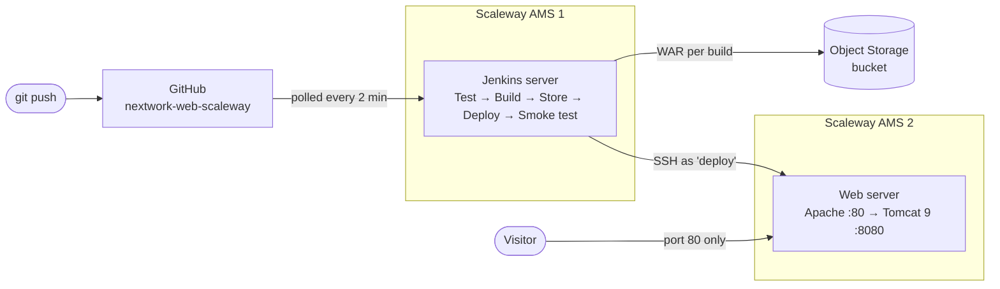

# CI/CD on Scaleway with Jenkins

A Java web app that goes from `git push` to live in about two minutes, with no manual steps. I first built this pipeline on AWS (CodePipeline, CodeBuild, CodeArtifact, CodeDeploy). Then I rebuilt it on **Scaleway** using **Jenkins**, to learn what a pipeline really does underneath the managed services.



## What it does

Every push to `master`:

1. **Test**: runs `run-tests.sh`
2. **Build**: `mvn clean package` on Java 17 produces `nextwork-web-project.war`
3. **Store**: uploads the WAR to a private Scaleway Object Storage bucket, under `builds/<build number>/`
4. **Deploy**: copies the WAR to the web server over SSH, as a limited `deploy` user, and swaps it into Tomcat
5. **Smoke test**: checks that the site answers within 60 seconds, and fails the build if it doesn't

## Tech stack

| Area | Used |
|---|---|
| Cloud | Scaleway: Instances, Object Storage, IAM, security groups (region `nl-ams`) |
| CI/CD | Jenkins LTS, declarative pipeline (`Jenkinsfile`) |
| Build | Java 17, Maven, maven-war-plugin 3.4.0 |
| Runtime | Ubuntu 22.04, Tomcat 9, Apache 2 reverse proxy |
| Tooling | Bash, OpenSSH, AWS CLI v2 (talking to S3-compatible Object Storage), Git, PowerShell |

## AWS → Scaleway translation

| On AWS | On Scaleway |
|---|---|
| EC2 | Instance |
| IAM role for a service | IAM **application** + API key |
| S3 artifact bucket | Object Storage (S3-compatible) |
| CodePipeline + CodeBuild + CodeDeploy | Jenkins + `Jenkinsfile` |
| CodeArtifact | Maven Central directly |
| CodeDeploy agent + `appspec.yml` | SSH + one `deploy-war.sh` script |

## Security choices

- **Least privilege everywhere.** Jenkins's Scaleway identity can only use Object Storage, in one Project. On the web server, the `deploy` user can run exactly one command with `sudo`, and nothing else.
- **No root for automation.** Day-to-day work happens as an IAM Member (`DevOps-IAM-Admin`); the Organization Owner only handles billing.
- **Default-deny firewalls.** Inbound traffic is dropped unless a rule allows it. The public reaches only port 80; Tomcat's 8080 is closed.
- **No secrets in Git.** API keys and the deploy key live in Jenkins credentials and are masked in build logs.
- **Budget alerts** at 25/50/80/100% of a €20 monthly budget.

## Problems I hit and how I fixed them

| Problem | Root cause | Fix |
|---|---|---|
| Port 8080 was reachable from the internet | The security group's **inbound default policy was Accept**, so the allow rules meant nothing | Set the default to Drop; verified with `curl -m 5` timing out |
| `Unable to load the mojo 'war'... Cannot access defaults field of Properties` | The default maven-war-plugin 2.2 can't run on Java 16+. AWS CodeBuild had used Java 8, so this never showed there | Pinned maven-war-plugin 3.4.0 and set the compiler level to 1.8 |
| `Load key: error in libcrypto` → `Permission denied (publickey)` | The SSH private key picked up Windows line endings (`\r`) on its way through the clipboard | The Deploy stage now cleans the key (`tr -d '\r'`) before using it |
| Emojis rendered as `🥳` | JSP defaults to ISO-8859-1, so UTF-8 bytes were misread | Added `pageEncoding="UTF-8"` and `<meta charset="UTF-8">` |
| Instance type out of stock in AMS 1 | Capacity varies by zone | Moved the web server to AMS 2. Security groups are per zone, so I created a matching one there |

## Repository layout

```
.
├── Jenkinsfile          # the whole pipeline: test, build, store, deploy, smoke test
├── .gitattributes       # keeps LF line endings on scripts, even when committed from Windows
├── pom.xml              # Java 1.8 target, maven-war-plugin 3.4.0
├── run-tests.sh
└── src/main/webapp/     # index.jsp (UTF-8), WEB-INF/web.xml
```

The server setup scripts (`setup-jenkins.sh`, `setup-webserver.sh`) and the full step-by-step guide are in the project guide.

## Cost

About €1–1.50 a day while both servers run (Jenkins BASIC3-X2C-4G at about €0.04 an hour, a small web server, and €0.005 an hour per public IPv4). Everything is torn down between sessions.

## What's next

- **Terraform**: the same infrastructure from a single `terraform apply`
- **GitHub Actions**: the same pipeline without a Jenkins server
- **Hybrid**: an AWS CodePipeline deploying to a Scaleway server registered as a CodeDeploy on-premises instance
